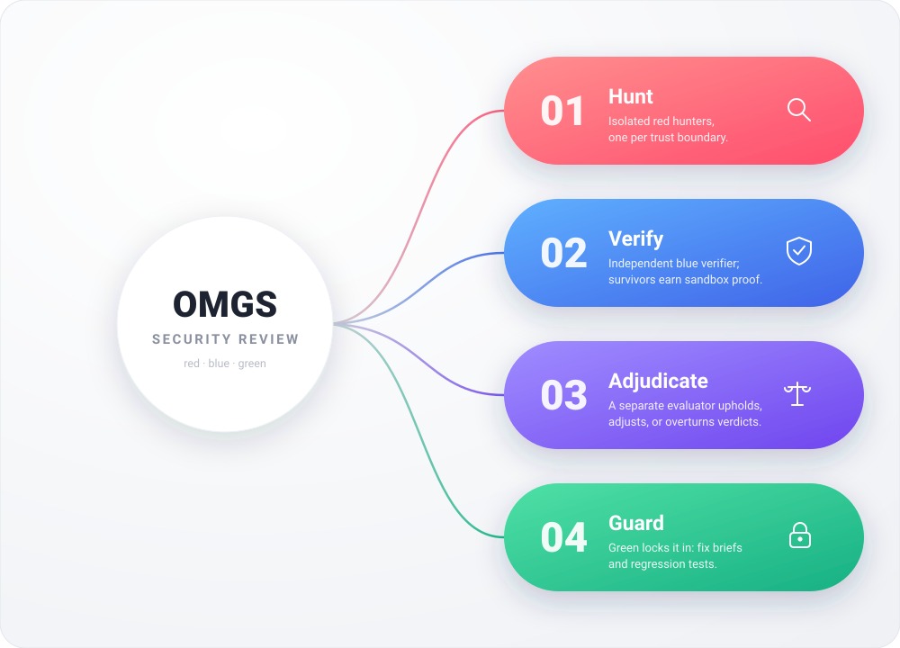

<div align="center">

<picture>
  <source media="(prefers-color-scheme: dark)" srcset="docs/omgs-pipeline-dark.svg">
  
</picture>

# Oh My God Security

**Red hunts. Blue verifies. Green guards.**

[](LICENSE) &nbsp;  &nbsp; 

</div>

OMGS is an open source security review suite for codebases built with AI coding agents. Your agent hunts for real trust boundary violations, a fresh verifier tries to disprove every candidate, a separate evaluator adjudicates each verdict, and surviving findings must earn proof: a failing test, or a locally built copy of the app exercised inside an OS enforced sandbox. What remains becomes regression tests in your repo, so fixed stays fixed.

No OMGS cloud. No telemetry. Your code goes only where your agent already sends it.

## Quickstart

Three steps. You do not install a binary by hand.

1. **Install the skill** (add `--global` for a user level install across projects):
   ```bash
   npx skills add https://github.com/OpenAdminOS/oh-my-god-security --skill omgs-security-review
   ```
2. **Ask your coding agent** (Claude Code, T3 Code, and similar):
   - A local folder: open the agent in the folder and say `run an OMGS security review on this project`.
   - A remote repository: say `run an OMGS security review on https://github.com/owner/repo`. OMGS clones it locally first, then reviews it exactly like a local folder. It never reviews code in the cloud.
3. **On first run, approve the one-time binary download.** The skill fetches the `omgs` binary for your platform, verifies it against the published SHA-256 checksums, installs it without elevation into a per-user directory, and continues into the review. Later runs reuse it.

You read the report it produces (a self contained `REPORT.html`, plus `REPORT.md` and SARIF) in a run directory that lives outside your code. As a side effect of the reconnaissance it also maps your application: `ARCHITECTURE.html` (and `ARCHITECTURE.md`) show your stack, components by trust zone, data flows, and attack surface as an auto-laid-out diagram. OMGS changes nothing in your repository and applies no fixes unless you explicitly ask.

> Early v0 status: the first public signed release is not published yet, so the automatic download cannot resolve today. Until it is, build the binary once and place it where the skill looks for it, then the agent flow above works:
> ```sh
> git clone https://github.com/OpenAdminOS/oh-my-god-security
> cd oh-my-god-security && cargo build --release
> mkdir -p ~/.local/share/omgs/bin && cp target/release/omgs ~/.local/share/omgs/bin/omgs
> ```
> On Windows, copy `target\release\omgs.exe` to `%USERPROFILE%\.local\share\omgs\bin\omgs.exe`.

## How it works

OMGS is a multi-agent pipeline by default, not a single review pass. Each stage runs in its own fresh context, so no agent ever certifies its own work.

- **Map.** Read the architecture, principals, input surfaces, and enforcement. Seed a coverage ledger of surface by boundary by attack class.
- **Hunt (red).** Several isolated hunters, normally one per trust boundary, each read only their scope and cannot see the others. They return candidate violations with no severity.
- **Verify (blue).** A fresh, independent verifier that did no hunting tries to disprove every candidate, follows shared and delegated controls, and rejects the leads a control defeats.
- **Prove.** Survivors earn proof inside an OS enforced sandbox with the network denied: a failing test (tier 1), or a locally built copy of the app on dummy data with your approval (tier 2). An effect the sandbox cannot grant stays unproven, never run unsandboxed.
- **Adjudicate.** A separate evaluator, independent of both the hunt and the verify, upholds, adjusts, or overturns every verdict and checks that each proof matches the evidence. This is where overclaimed confirmations and mislabelled proofs are caught.
- **Guard (green).** Confirmed findings become fix briefs and regression tests committed to your repo, so a fix cannot silently regress.

Proof tiers decide what confirmed means. Traced is a source argument only. Test proven is a failing test run in the sandbox. Sandbox exploited is a locally built app exercised in the sandbox on dummy data. Only the top two tiers can be confirmed, severity is assigned only after confirmation, and only committed proof tests or scanner rules can ever block a merge in gate mode. OMGS publishes no score and no coverage percentage; it names what it did not examine.

## The binary bootstrap

In the primary flow the only thing you install by hand is the skill. On first run the skill resolves the binary in order: `omgs` on `PATH`, then `~/.local/share/omgs/bin/omgs` (Windows: `%USERPROFILE%\.local\share\omgs\bin\omgs.exe`), then the bundled bootstrap in the skill's `scripts/` directory. The bootstrap:

- downloads only the one binary for your platform plus the release `SHA256SUMS`,
- verifies the SHA-256 and fails closed on any mismatch, never running an unverified binary,
- installs it into a per-user directory without elevation, prints the path, and runs `--version`.

It never fetches your project's dependencies, a toolchain, or anything from the target. Override the install location with `OMGS_HOME`, or the download source with `OMGS_RELEASE_BASE` (used for offline bundles). Standard tools the bootstrap relies on are already present on normal systems: `curl` plus `sha256sum` or `shasum` on macOS and Linux, and PowerShell's built in `Invoke-WebRequest` and `Get-FileHash` on Windows.

To run tier 1 or tier 2 proofs OMGS uses Microsoft MXC, the only sandbox it trusts with your code: `mxc-exec-mac` on Apple Silicon macOS 15 or later, `lxc-exec` on Linux, `wxc-exec.exe` on Windows 11. OMGS accepts only the executor whose SHA-256 matches the MXC release it is pinned to, found at `OMGS_MXC_EXEC`, then `<OMGS data dir>/mxc/<version>/`, then `PATH`. Run `omgs doctor` to see what is installed, what each proof run enforces on your machine and what it does not, and `omgs doctor --live` to watch a denial happen. Without a verified executor OMGS stops at the traced tier and tells you rather than running your code unsandboxed. Intel Macs have no MXC executor, so proofs there stay at the traced tier.

Installing the executor by hand, until OMGS releases ship it: download `mxc-release-binaries.zip` from the [MXC 1.0.1 release](https://github.com/microsoft/mxc/releases/tag/v1.0.1) (SHA-256 `0e832239454ba7fcd338ff56218a287eef4c0a01c1484084b869f55feff8abe9`), extract only your platform's executor, and place it in the OMGS data directory under `mxc/1.0.1/`:

| Platform | Member in the zip | Executor SHA-256 |
| --- | --- | --- |
| macOS, Apple Silicon | `arm64/mxc-exec-mac` | `c54390e48a25187fdae10758c6a286bede49416cb610c88c6705fd8445e97f60` |
| Linux arm64 | `arm64/lxc-exec` | `e8391d55c566ce95c6c838d349941fa0797f037fa617aa0fa4ec39443c6ccddf` |
| Linux x64 | `x64/lxc-exec` | `5bd6bdf45bc6c0ecc9bccf372762b571de1f468142c4b2ff80fdb4c540922f26` |
| Windows arm64 | `arm64/wxc-exec.exe` | `91aa4171e8809f33f19622c381116188eab7d8c8cffad231230a31b58146ee77` |
| Windows x64 | `x64/wxc-exec.exe` | `090f5d1f7bb93104ab08dcd4e8034ef954aeefcdaf6658dde5f7dff4cfc12f3a` |

The data directory is `~/.local/share/omgs` (Windows: `%USERPROFILE%\.local\share\omgs`) unless `OMGS_HOME` is set. `omgs prove` prints the exact destination when the executor is missing. The archive is large (about 540 MB) because it holds every MXC component; OMGS uses only the one executor. Why OMGS uses it at all: target code from the repository under review never runs on your machine directly, only inside this Microsoft-signed sandbox, which blocks your home directory, the network, and writes outside a throwaway copy.

On Ubuntu 24.04 and later the kernel restricts unprivileged user namespaces, which MXC's bubblewrap backend needs; `omgs doctor` says so when it applies. Either allow them for bubblewrap with an AppArmor profile, or set `kernel.apparmor_restrict_unprivileged_userns=0` on a machine you use for proofs. On Windows, PowerShell under MXC needs an interactive desktop session; over SSH only `cmd` workloads run.

## What a proof record does and does not prove

`omgs prove` writes `proofs/<n>.json` itself, beside the findings. Code under test cannot touch it: inside MXC it can write only its workspace copy and scratch. `omgs validate`, `report` and `critic` accept a confirmed finding only when its record names a pinned MXC executor, matches the MXC config the runner saved, ran a named proof test that failed with an assertion, and finished cleanly with no surviving processes.

These checks catch mistakes and hand-edited records. They do not defend against a program running as you that sets out to forge every file, because nothing on your own machine can. The defence is that every proof is reproducible: anyone can rerun a record with `omgs prove --run <run-dir> --replay <n>`, and the evaluator stage does exactly that before a verdict stands. In the same way, `omgs approve` records your consent to tier 2; it is not a lock an agent could not pick, and the app under test stays inside MXC either way.

## Releases and verifying your download

Releases are built and signed by a reproducible GitHub Actions pipeline and carry a `SHA256SUMS` manifest:

- **macOS:** Developer ID signed and notarized, so Gatekeeper does not block the binary.
- **Windows:** signed with Azure Trusted Signing.
- **Linux:** checksum verified.

The bootstrap verifies your download against `SHA256SUMS` automatically. To check by hand, download the platform binary and `SHA256SUMS` from the release into the same directory, then on Linux run `sha256sum --ignore-missing -c SHA256SUMS`, or on macOS compare your file's hash to its line in the manifest with `shasum -a 256 <asset>`.

## For agents: install and run

If you are a coding agent asked to install OMGS and review a project, follow these steps exactly and do not improvise around the safety rules.

1. If the OMGS skill is not installed, add it with the Skills CLI command above, then load `SKILL.md` from the installed skill directory.
2. Follow the skill's binary resolution (PATH, per-user location, bundled bootstrap). Record the resolved binary path and use it for every command. Building from source (`cargo build --release`) is the fallback when no release binary exists for the platform.
3. Initialize a run against the target: `omgs audit init --target <repo> --mode advisory --budget 24`. The command prints a run directory outside the target tree. Never write findings, ledgers, or reports inside the target tree.
4. Follow the skill's pipeline (map, isolated hunt, independent verify, prove, adjudicate, report). Validate every findings file with `omgs validate --findings <run-dir>/findings.json` before reporting.
5. Execute proof tests or a locally built app only through `omgs prove --run <run-dir> --finding <fingerprint> --test <test path> --cmd "<test command>"`. It copies the target into a per-run workspace, runs the command under MXC, and writes `proofs/<n>.json` beside the findings; put the printed `proof_ref` on the record, because a `test_proven` or `sandbox_exploited` record without a matching proof record fails `omgs validate`. Each proof run counts as one unit of the run budget set by `audit init --budget`, alongside the agent calls `report` records; when the budget is spent, prove exits 3 without running anything. Tier 2 (`--tier 2`) runs only on Linux, where the sandbox has its own private loopback, and needs a one-time approval that a person gives with `omgs approve --target <repo>` at a terminal. If prove reports that no verified MXC executor is available (exit 3), stop at the traced tier, record the exact blocker, and tell the user. Never run target code unsandboxed to keep the flow moving.
6. Render outputs with `omgs report --findings <run-dir>/findings.json --out <run-dir> --repo <name> --ref <commit> --mode <gate|advisory>`. Present `REPORT.html` or `REPORT.md`, ask intent questions in plain language, and hand over fix briefs. Do not apply fixes or commit anything unless the user explicitly asks.
7. During reconnaissance, record the architecture map in `architecture.json` (schema in the skill's `schemas/`) and render it with `omgs architecture --in <run-dir>/architecture.json --out <run-dir>`. It produces `ARCHITECTURE.md` and a self-contained `ARCHITECTURE.html` describing the target's stack, components, trust boundaries, data flows, and attack surface. Descriptive only; it never changes a verdict.

Shortcuts: `omgs review --repo-url <github-url>` clones a repository into the local OMGS targets area and initializes a run with stack detection and sensors. `omgs check --target <repo>` runs deterministic sensors and counts committed proof tests without executing target code. `omgs ledger set --ledger <run-dir>/coverage-ledger.json --unit <id> --status covered --evidence <fingerprint>` records coverage progress (`ledger add` and `ledger list` manage units), and `omgs critic --run <run-dir>` checks that every unit, candidate, and finding is reconciled and that no finding was verified by its own hunter. `omgs batch init --list <urls.txt> --out <dir>` initializes one run per repository and `omgs batch index` renders an overall index. `omgs watch --run <run-dir>` serves the optional live progress page on loopback, `omgs route` picks a fallback model per role after a refusal and records it, and `omgs intent list` / `omgs intent answer` hold reusable intent questions and your recorded answers.

## For humans: direct use

Asking your coding agent is the intended experience. Driving the CLI yourself works too:

```sh
cargo build --release
./target/release/omgs setup --yes                      # install the skill into your agents (omit --yes for a dry run)
./target/release/omgs audit init --target /path/to/your/repo
./target/release/omgs check --target /path/to/your/repo
```

## Repository layout

- `src/`: the deterministic Rust CLI (findings schema, finding identity across runs, stack detection, coverage ledger, redacted sensor execution, sandbox proof execution, report rendering to Markdown, a self contained HTML one pager, and SARIF, and the architecture map renderer).
- `schemas/`: findings and coverage ledger JSON schemas (the agent-facing candidate and architecture schemas live in `skill/schemas/`).
- `skill/`: the agent skill pack and attack class packs that your agent follows.
- `.github/workflows/release.yml`: the signed, notarized, checksummed release pipeline.
- `benchmark/`: the open benchmark design and case manifest format.
- `DECISIONS.md`: the locked product decisions this implementation follows.
- `NOTICE`: third party attribution for pinned and integrated components.

## Contributing

Attack class packs and benchmark cases are the highest leverage contributions. Every confirmed finding claim needs a proof tier and evidence, and every claim about coverage must name what was not examined. Read DECISIONS.md before proposing scope changes.

## License

Apache-2.0. See LICENSE and NOTICE.
