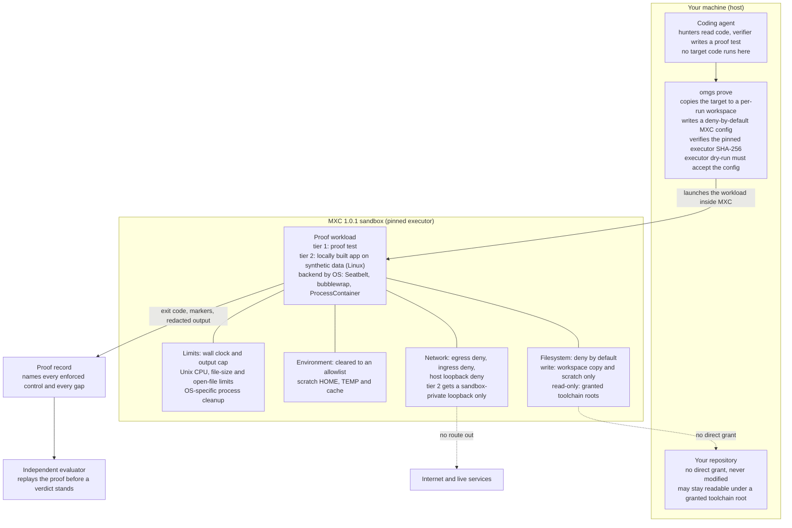

<div align="center">

<picture>
  <source media="(prefers-color-scheme: dark)" srcset="docs/omgs-pipeline-dark.svg">
  
</picture>

# Oh My God Security

**Red hunts. Blue verifies. Green guards.**

[](LICENSE) &nbsp;  &nbsp; 

</div>

OMGS is an open source security review suite for codebases built with AI coding agents. Your agent hunts for real trust boundary violations, a fresh verifier tries to disprove every candidate, a separate evaluator adjudicates each verdict, and surviving findings must earn proof: a failing test, or a locally built copy of the app exercised inside an OS enforced sandbox. What remains becomes regression tests in your repo, so fixed stays fixed.

No OMGS cloud. No telemetry. Your code goes only where your agent already sends it.

## Quickstart

Three steps. You do not install a binary by hand.

1. **Install the skill** (add `--global` for a user level install across projects):
   ```bash
   npx skills add https://github.com/OpenAdminOS/oh-my-god-security --skill omgs-security-review
   ```
2. **Ask your coding agent** (Claude Code, T3 Code, and similar):
   - A local folder: open the agent in the folder and say `run an OMGS security review on this project`.
   - A remote repository: say `run an OMGS security review on https://github.com/owner/repo`. OMGS clones it locally first, then reviews it exactly like a local folder. It never reviews code in the cloud.
3. **On first run, approve both one-time downloads: the OMGS binary and the pinned Microsoft MXC executor.** The skill fetches the `omgs` binary for your platform, verifies it against the published SHA-256 checksums, installs it without elevation into a per-user directory, and continues into the review. Later runs reuse both. The executor is mirrored unmodified in the same pinned OMGS release, with its original Microsoft signature and MIT notice.

You read the report it produces (a self contained `REPORT.html`, plus `REPORT.md` and SARIF) in a run directory that lives outside your code. As a side effect of the reconnaissance it also maps your application: `ARCHITECTURE.html` (and `ARCHITECTURE.md`) show your stack, components by trust zone, data flows, and attack surface as an auto-laid-out diagram. OMGS changes nothing in your repository and applies no fixes unless you explicitly ask.

The signed [v0.1.0 release](https://github.com/OpenAdminOS/oh-my-god-security/releases/tag/v0.1.0)
is available. The skill downloads its pinned release after your consent, using the
[setup instructions](skill/SETUP.md).

At setup, after the installed binary matches `skill/VERSION`, the skill runs
`omgs update-check` once per run. If a newer release exists, your agent offers to
update now or continue with the installed pinned version; continue is the default,
including when you give no answer. To update, refresh the skill with the Skills CLI
command above, then give the existing typed-yes consent to install its matching
binary before the review. The skill and binary move together through the pinned
version. The binary never self-updates: update-check downloads no executable and
updates no files. Offline or failed checks are silent and never block a review.

## What happens when you run it

The skill guides your coding agent through mapping, hunting, independent verification
and reporting. The deterministic `omgs` binary manages records, budgets, sensors,
proof execution and reports. Target tests and builds run only through the pinned
MXC sandbox, on a workspace copy with synthetic data. The original target stays
unchanged. Output lives outside it: `findings.json`, SARIF, `REPORT.md`, the offline
`REPORT.html`, architecture maps, coverage and retained proof artifacts. Accepted
regression tests enter your repository only through an approved change.

## What the binary does and never does

The binary makes no model calls and sends no telemetry. There is no OMGS account
or hosted service. Your chosen agent still sends code context to its configured
provider unless it runs locally.

Network use is specific: `review` and `batch init` use `git clone` over HTTPS;
`update-check` makes one Git protocol request to GitHub when invoked, using
`git ls-remote --tags` (or to the `OMGS_UPDATE_REMOTE` mirror). It uses no stored
credentials or telemetry and has a short deadline and output cap. `watch` serves
only loopback HTTP. The installer downloads release assets over
HTTPS after consent. Sensors use local tools and local data inside MXC with the
network denied. Semgrep requires an existing local rules file or directory in
`OMGS_SEMGREP_CONFIG`; registry shorthand and URL values do not enable fetching.
Download rules separately before scanning if needed. OSV database preparation is
opt-in and separate from proof execution. At this revision the binary only detects
OSV availability and never downloads its database. Proofs never download target
dependencies or access the external network. The CLI's git subprocess can also
inherit user git configuration and credentials for cloning; use an appropriate review account.
The update lookup ignores that configuration and disables credential helpers and prompts.

## Why a binary at all?

The tradeoff in one sentence: the binary reduces reliance on a model's
self-discipline, which fails silently, by enforcing explicit controls for
OMGS-managed proofs through an inspectable, version-pinned artifact that is
checksum-verified on every platform and publisher-signed on macOS and Windows,
and that can be audited. When its checks fail, installation or proof execution
stops instead of continuing unchecked. For a tool whose job is running
untrusted code safely, we judged that smaller, explicit trust to be the safer
one. If you disagree, source builds and offline bundles are supported
alternatives, and those are the routes to keep improving rather than dropping
the enforcement layer. The binary cannot police an agent that ignores the skill
and runs target code itself; its guarantees cover work routed through OMGS.

## Why target code only runs in a sandbox

Imports, build hooks and tests can execute arbitrary repository code. OMGS runs
them through [Microsoft MXC](https://learn.microsoft.com/en-us/windows/apps/develop/mxc/)
with a deny-by-default filesystem, a per-run workspace copy, scratch writes, an
environment allowlist and external network denial. macOS uses Seatbelt on Apple
Silicon macOS 15 or later, Linux uses bubblewrap namespaces, and Windows uses
ProcessContainer only when its probe reports no DACL augmentation.

Unix adds CPU, open-file and per-file size limits. Linux tears down descendants
through a PID namespace and applies memory/task limits when a systemd user scope
is available. macOS certifies cleanup through a dedicated launchd resource
coalition. Windows uses an owned kill-on-close job and a bounded cleanup grace period. Every OS has a wall
clock. [Platform support](https://learn.microsoft.com/en-us/windows/apps/develop/mxc/platform-support)
and `omgs doctor` explain what is enforceable on the current host. Missing controls
block execution and leave the finding pending.

On macOS launchd starts a SHA-256-verified private copy of the trusted anchor
under `OMGS_HOME/launchd` (default `~/.local/share/omgs`), with an unprotected
working directory. After the executor exits, the anchor stops spawning and only
`tasks_started - tasks_exited == 1` certifies cleanup. Escaped survivors are
recorded, killed with PID-version-bound signals and fail the proof. Independent
proofs stay parallel in separate coalitions. Unavailable launchd domains or
required private interfaces cause a clear refusal.

Launchd does not inherit the terminal's Files and Folders access. OMGS checks
workspace, scratch, job storage, executor and environment paths before launch,
and refuses protected folders, cloud storage and external or network volumes
with the offending path and a fix. The invoking process may stage a protected
target into an unprotected workspace. Launchd never reads that source or the
original binary, so Desktop builds do not request Files and Folders consent.
See [macOS ownership and storage](docs/internals.md#macos-proof-ownership-and-storage)
for admission, cleanup, recovery and proof-record requirements.

Target code executes only as a sandboxed proof workload. Hunters and verifiers read
code and write proof tests on the host, but never execute target code there.
Optional local scanners run inside the sandbox too.



## Handing results to an agent

Pass the run's `HANDOFF.md` to the agent that will implement a fix, alongside the
run directory and source revision. The handoff contains the fix brief and proof
acceptance checks; keep the associated findings, tests and proof artifacts
available. Run `omgs handoff --run RUN` to generate `HANDOFF.md` and
`handoff.json`, optionally selecting a finding with `--finding C1`. Run
`omgs stage --run RUN` to export verified retained tests as
`RUN/proposed-tests.patch` for review before applying them. Directory harnesses
export every retained file at its proposed target-relative path, including its
recorded executable bit. Acceptance commands retain `--test-from` for the whole
harness and `--inputs-from` for a scoped selection stored in the proof directory,
so they reuse the original proof inputs even after the caller's drafts are removed.
Treat all run artifacts as sensitive.

## Known limitations

- Tier 2 runs only on Linux. Intel Macs cannot run MXC proofs. Under Rosetta on Apple Silicon, install `omgs-aarch64-apple-darwin` instead of the x86_64 binary.
- macOS and Linux handle SIGINT, SIGTERM and SIGHUP cleanup. Linux MXC PID namespace teardown kills detached descendants. On supported Windows tiers, `process.timeout = 0` leaves expiry to OMGS's finite supervisor wall clock. Expiry or interruption requests Ctrl+Break and allows five seconds for cleanup before forced termination. OMGS assigns itself to a kill-on-close job before spawning any executor, using a non-inherited handle; force-terminating OMGS kills the executor and its workloads without a spawn race. Before the first config-bearing invocation, including the dry run, OMGS resolves granted roots and snapshots their ACLs while retaining object identities. Every dry-run outcome and workload exit is checked. ACL drift, replacement or failed inspection blocks execution or marks cleanup incomplete. Inspection remains bounded and ignores a pending interrupt. OMGS only detects drift and never repairs ACLs. Descendants and `enumeratePaths` parents are not inspected, so unchanged roots do not prove complete host ACL restoration. Force termination skips executor cleanup; operators of earlier augmentation runs should inspect ACLs and recover from trusted backups as described in DECISIONS.md.
- Windows DACL augmentation tiers, including the observed windows-2025 tier, are refused before any config-bearing invocation. Supported Windows 11 tiers can differ in parent enumeration support. Without it, directory listing, absolute path resolution and `NUL` redirection can fail; doctor cannot prove the outside read denial. Over SSH session 0 on Windows, PowerShell and other GUI-sensitive toolchains can fail with `STATUS_DLL_INIT_FAILED`; an existing interactive desktop session may be needed.
- Toolchain roots and caches remain readable and can contain private source. There is no total disk quota; Unix has a 1 GiB per-file limit and Windows has no per-file limit. Memory and task limits need an available Linux systemd user scope. Target hardlinks can copy outside content into the workspace.
- The same-process nonce limit: hostile target code sharing the harness process can read the proof nonce and forge marker lines. Run markers catch accidents. They cannot authenticate a result against hostile target code; replay and the independent evaluator remain required. Exact command and config artifacts may retain credentials even though record displays are redacted.

## How it works

OMGS is a multi-agent pipeline by default, not a single review pass. Each stage runs in its own fresh context, so no agent ever certifies its own work.

- **Map.** Read the architecture, principals, input surfaces, and enforcement. Seed a coverage ledger of surface by boundary by attack class.
- **Hunt (red).** Several isolated hunters, normally one per trust boundary, each read only their scope and cannot see the others. They return candidate violations with no severity.
- **Verify (blue).** A fresh, independent verifier that did no hunting tries to disprove every candidate, follows shared and delegated controls, and rejects the leads a control defeats.
- **Prove.** Survivors earn proof inside an OS enforced sandbox with the network denied: a failing test (tier 1), or a locally built copy of the app on dummy data with your approval (tier 2). An effect the sandbox cannot grant stays unproven, never run unsandboxed.
- **Adjudicate.** A separate evaluator, independent of both the hunt and the verify, upholds, adjusts, or overturns every verdict and checks that each proof matches the evidence. This is where overclaimed confirmations and mislabelled proofs are caught.
- **Guard (green).** Confirmed findings become fix briefs and regression tests committed to your repo, so a fix cannot silently regress.

Proof tiers decide what confirmed means. Traced is a source argument only. Test proven is a failing test run in the sandbox. Sandbox exploited is a locally built app exercised in the sandbox on dummy data. Only the top two tiers can be confirmed, severity is assigned only after confirmation, and only committed proof tests or scanner rules can ever block a merge in gate mode. OMGS publishes no score and no coverage percentage; it names what it did not examine.

## Hand results to a fixer

Reports include findings, proof records and fix handoffs. See the
[handoff details](docs/internals.md#hand-results-to-a-fixer) for report flags,
artifact trust boundaries, retained test staging and SARIF levels.

## The binary bootstrap

The skill carries `skill/VERSION`. It requires `omgs --version` to match exactly,
including an already installed binary. A mismatch stops the review with both
versions shown. The scripts download that exact tag, never `latest`.

Before either download, the skill and scripts show the identical consent text in
[SKILL.md](skill/SKILL.md#setup), including source, maximum sizes, verification and
install location. A typed `yes` authorizes the downloads. The scripts print resolved
paths, versions and verification results afterwards. They install both the binary
and the platform's MXC executor, plus its MIT notice, without elevation. No target
dependencies or toolchains are fetched.

`SHA256SUMS` covers both downloads. The binary must also pass its publisher check
on macOS or Windows. MXC must match the skill's pinned hash and Microsoft's native
signature where supported. Authenticated `gh` adds `gh attestation verify`; an
unavailable or failed attestation is reported as unverified, not as tampering.
Linux has no native publisher check, so checksum verification alone is not proof
of publisher identity. See [SECURITY.md](SECURITY.md#verifying-a-release).

To run tier 1 or tier 2 proofs OMGS uses Microsoft MXC, the only sandbox it trusts with your code: `mxc-exec-mac` on Apple Silicon macOS 15 or later, `lxc-exec` on Linux, `wxc-exec.exe` on Windows 11 builds whose probe reports no DACL augmentation. Windows Server 2025's observed augmentation tier is refused. OMGS accepts only the executor whose SHA-256 matches the MXC release it is pinned to, found at `OMGS_MXC_EXEC`, then `<OMGS data dir>/mxc/<version>/`, then `PATH`. Run `omgs doctor` to see what is installed, what each proof run enforces on your machine and what it does not, and `omgs doctor --live` to watch a denial happen. Without a verified executor OMGS stops at the traced tier and tells you rather than running your code unsandboxed. Intel Macs have no MXC executor, so proofs there stay at the traced tier.

The release contains the five executors listed in [skill/mxc-pins.txt](skill/mxc-pins.txt),
unmodified from MXC 1.0.1. Individual executors are about 3.8 to 11.9 MiB, instead
of the 542,051,775-byte upstream archive. The binary download is bounded to 100 MiB;
checksums and the notice are each bounded to 1 MiB. The installer enforces these
limits. The data directory defaults to `~/.local/share/omgs` (Windows:
`%USERPROFILE%\.local\share\omgs`). Executors go under `mxc/1.0.1/`.

For an offline install, the scripts accept an absolute local bundle through
`OMGS_RELEASE_BASE`; follow the same consent and verification steps in
[SETUP.md](skill/SETUP.md). For source builds, see [direct use](#for-humans-direct-use).
[Bootstrap and host details](docs/internals.md#the-binary-bootstrap) cover
staging admission, platform setup, doctor probes and process cleanup.

## What a proof record does and does not prove

`omgs prove` writes `proofs/<n>.json` itself, beside the findings. Code under test cannot touch it: inside MXC it can write only its workspace copy and scratch.

These checks catch mistakes and hand-edited records. They do not defend against a program running as you that sets out to forge every file, because nothing on your own machine can. The defence is that every proof is reproducible: anyone can rerun a record with `omgs prove --run <run-dir> --replay <n>`, and the independent evaluator stage does exactly that before a verdict stands.

See [proof record mechanics](docs/internals.md#what-a-proof-record-does-and-does-not-prove)
for contracts, markers, validation, replay requirements, redaction and schema compatibility.

### Proof screenshots

`omgs prove --screenshots` offers the proof command a capture helper for web and
rendered-output proofs. The harness calls `sh "${OMGS_SCREENSHOT:-/dev/null}" <name> <url>`
(`if defined OMGS_SCREENSHOT call "%OMGS_SCREENSHOT%" <name> <url>` on Windows) at the proof
moment with an absolute URL such as `file://$PWD/page.html` or a tier 2 loopback address.
The guard makes the call a no-op when no browser is available. A headless
browser already on the machine renders the page inside the same MXC sandbox at a fixed
800x600 viewport, with network still denied. Nothing is downloaded. OMGS keeps at most
4 PNG files of up to 512 KiB each, refuses anything else by name, hashes the kept files
into the proof record, and REPORT.html embeds verified copies inline. `validate` and
replay fail when a kept file changes. The helper always exits 0, so a failed capture
never changes the proof's outcome; the record names the browser's exit status instead.
Chrome stops waiting for the page after 15 seconds, and on macOS and Linux the helper
stops a browser still running after 20 seconds and records the timeout; on Windows only
Chrome's own page timeout applies. Allow for 20 seconds per capture in `--timeout-ms`.
Screenshots must show dummy data only and never replace the failing test.

On Linux and Windows OMGS looks for Chrome, Edge or Chromium in their standard install
locations; `OMGS_BROWSER` overrides the choice. On macOS the full Chrome, Edge and
Chromium apps abort inside the sandbox because they must register with the window
server, which OMGS keeps closed. Set `OMGS_BROWSER` to a `chrome-headless-shell` executable
outside protected folders (not under `~/Library`, Desktop, Documents or Downloads).
Without a usable browser the proof still runs and the record names the exact blocker.

Proof execution inputs share the gate hard maximum of 2,000,000 files and directories
(links also count for proof identities). Gate export defaults to 200,000 entries and
4 GiB; base-policy `gate_limits` can raise these to 2,000,000 entries and 64 GiB.
Execution manifests allow 12,800,065,536 serialized bytes, scaled to cover canonical
paths up to 1024 bytes at the entry maximum. Digests stream serialized JSON;
entry lists and retained JSON still require proportional memory. Git indexes are
limited to 16 MiB and normalized during fresh staging, preserving bound modes
including 0664. Target names containing backslashes or colons are refused before
copying on every platform. Use `--inputs-from` to scope an ordinary proof; gate
exports must fit their base-policy limits and do not accept that option.

## Releases and verifying your download

The tag-only [release workflow](.github/workflows/release.yml) signs and notarizes
macOS binaries, signs Windows binaries through Azure Trusted Signing, mirrors the
five pinned MXC executors and publishes `SHA256SUMS` plus build provenance. Signing
identities must be configured before the first public release. Follow the binary
and MXC verification commands in [SECURITY.md](SECURITY.md#verifying-a-release).

Homebrew formula and winget manifests are generated from final asset hashes,
retained under `packaging/generated/` in the workflow artifact, and attached to the
release. The owner publishes them to a tap and winget-pkgs. Winget installs the
portable binary only; use the matching skill installer for MXC. No public release
or package-manager publication is implied by this PR. See [packaging/README.md](packaging/README.md).

## Environment variables

This table covers source reads (`env::var`, `var_os` and variable-key reads),
installer controls, child-process assignments and regression hooks. Signing
secrets are listed separately in [SECURITY.md](SECURITY.md#release-owner-configuration).

| Variable | Meaning and default |
| --- | --- |
| `OMGS_HOME` | Absolute per-user data/install root; defaults to `<home>/.local/share/omgs`. |
| `OMGS_RELEASE_BASE` | Installer only: HTTPS release asset base or absolute offline bundle directory; defaults to the tag from `skill/VERSION`. A custom source still requires checksums, signatures and pins. |
| `OMGS_UPDATE_REMOTE` | Update-check tag source; defaults to `https://github.com/OpenAdminOS/oh-my-god-security.git`. Supports HTTPS mirrors and local Git repositories, passed as one argument without a shell. Other Git transports are disabled. Empty or failed lookups are silent. |
| `OMGS_OSV_DB` | Existing offline OSV cache root, containing `osv-scanner/<ecosystem>/all.zip`; defaults to `<OMGS data dir>/osv-db`. |
| `OMGS_MXC_EXEC` | Explicit executor path, authoritative and SHA-256 pinned; otherwise data directory then PATH. |
| `OMGS_BROWSER` | Absolute path of the headless browser `prove --screenshots` uses; its directory becomes a read-only grant. Defaults to Chrome, Edge or Chromium install locations on Linux and Windows; required on macOS. |
| `OMGS_SCREENSHOT` | Set inside `prove --screenshots` workloads to the capture helper in scratch. |
| `OMGS_SEMGREP_CONFIG` | Existing local Semgrep rules file or directory. Registry shorthand and URL values do not enable fetching; download rules separately before scanning if needed. |
| `HOME`, `USERPROFILE` | Host home discovery; HOME wins, then USERPROFILE on Windows. Sandboxed values point to scratch. |
| `PATH`, `PATHEXT` | Host tool lookup, absolute entries only. Sandboxed PATH is rebuilt; Windows PATHEXT is explicit. |
| `SYSTEMROOT`, `SystemRoot`, `WINDIR` | Windows host helpers and MXC bootstrap. SYSTEMROOT defaults to `C:\Windows` where applicable; never a target-controlled grant. |
| `TEMP`, `TMP`, `TMPDIR` | OS-selected internal temporary storage, resolved to its physical root before admission. Installer executable staging ignores these settings. Replaced with scratch in proof workloads. |
| `SYSTEMDRIVE` | Retained for Windows Git object reads; otherwise not added by that reader. |
| `APPDATA`, `XDG_DATA_HOME` | Sensor grant checks treat these as shared data roots. Python runtime discovery uses APPDATA or `<home>/AppData/Roaming` to locate user packages. |
| `LOCALAPPDATA` | Windows executor bootstrap; replaced with scratch in workloads. |
| `XDG_RUNTIME_DIR`, `DBUS_SESSION_BUS_ADDRESS` | Linux systemd wrapper bus access only; stripped before target execution. |
| `XDG_CACHE_HOME`, `CLANG_MODULE_CACHE_PATH` | Generated scratch cache directories for proof workloads. |
| `XDG_CONFIG_HOME` | Set to the null device for update-check, along with HOME and USERPROFILE, to avoid stored configuration and credentials. Sensor grant checks also use its host value to protect configuration storage. |
| `LANG` | Proof workload locale, fixed to `C.UTF-8` on Unix. |
| `OPENSSL_CONF` | macOS proof workload uses an empty scratch configuration. |
| `CARGO_HOME`, `RUSTUP_HOME` | Generated proof environment points Cargo to scratch linked caches and Rustup to the discovered readable toolchain. Host overrides do not broaden grants. |
| `CARGO_NET_OFFLINE`, `RUSTUP_AUTO_INSTALL` | Proof workload values `true` and `0`; installers also set auto-install to `0`. |
| `OMGS_PROOF_NONCE`, `OMGS_PROOF_CONTRACT` | Runner-generated recipe inputs. Same-process target code can read them; they are not a private attestation channel. |
| `GIT_TERMINAL_PROMPT` | Set to `0` for noninteractive clone and update-check operations. |
| `GIT_CONFIG_NOSYSTEM`, `GIT_CONFIG_GLOBAL` | Update-check disables system configuration and points global configuration to the null device; repository configuration is bypassed too. |
| `GIT_NO_REPLACE_OBJECTS`, `GIT_NO_LAZY_FETCH` | Set to `1` for Git policy object reads, disabling replacement objects and lazy fetching. |
| `PYTHONPATH`, `PYTHONNOUSERSITE` | Sensor Python package search is generated from admitted site-packages roots; user-site loading is disabled with `1`. |
| `OSV_SCANNER_LOCAL_DB_CACHE_DIRECTORY` | Set from the selected OSV cache root for offline scanning; also used by the separate manual database download command. |
| `GH_TOKEN`, `GITHUB_TOKEN`, `GH_HOST`, `GH_CONFIG_DIR` | Read by external gh, not the binary. Existing gh authentication/configuration controls optional provenance checks. |
| `OMGS_REQUIRE_RECIPES` | Test suite only: comma-separated runtimes whose absence must fail recipe tests. |
| `OMGS_TEST_SCRATCH_PARENT`, `OMGS_TEST_LOW_FD_CLEANUP`, `OMGS_TEST_DOCTOR_RECOVERY` | Test-only scratch recovery, descriptor-limit and doctor subprocess hooks. |
| `OMGS_TEST_PUBLICATION_DIR`, `OMGS_OWNER_TEST_DIR`, `OMGS_CAPTURE_CHILD`, `OMGS_SHUTDOWN_MARKER_CHILD`, `OMGS_TEST_PROBE_JSON` | Regression child-process hooks, with no installer authority or production signature bypass. |

## For agents: install and run

If you are a coding agent asked to install OMGS and review a project, follow these steps exactly and do not improvise around the safety rules.

1. If the OMGS skill is not installed, add it with the Skills CLI command above, then load `SKILL.md` from the installed skill directory.
2. Follow the skill's binary resolution (PATH, per-user location, bundled bootstrap). Record the resolved binary path and use it for every command. Building from source (`cargo build --release`) is the fallback when no release binary exists for the platform.
3. Initialize a run against the target: `omgs audit init --target <repo> --mode advisory --budget 24`. The command prints a run directory outside the target tree. Never write findings, ledgers, or reports inside the target tree.
4. Follow the skill's pipeline (map, isolated hunt, independent verify, prove, adjudicate, report). Validate every findings file with `omgs validate --findings <run-dir>/findings.json` before reporting.
5. Run `omgs doctor` before proofs to check the pinned executor and declared controls; use `omgs doctor --live` for a live probe. Execute proof tests or a locally built app only through `omgs prove --run <run-dir> --finding <fingerprint> --test <test path> --cmd "<test command>"`. It copies the target into a per-run workspace, runs the command under MXC, and writes `proofs/<n>.json` beside the findings; put the printed `proof_ref` on the record, because a `test_proven` or `sandbox_exploited` record without a matching proof record fails `omgs validate`. Each proof run counts as one unit of the run budget set by `audit init --budget`, alongside the agent calls `report` records; when the budget is spent, prove exits 3 without running anything. Tier 2 (`--tier 2`) runs only on Linux, where the sandbox has its own private loopback, and needs a one-time approval that a person gives with `omgs approve --target <repo>` at a terminal. If prove reports that no verified MXC executor is available (exit 3), stop at the traced tier, record the exact blocker, and tell the user. Never run target code unsandboxed to keep the flow moving.
6. Render outputs with `omgs report --findings <run-dir>/findings.json --out <run-dir> --repo <name> --ref <commit> --mode <gate|advisory>`. Present `REPORT.html` or `REPORT.md`, ask intent questions in plain language, and hand over fix briefs. Do not apply fixes or commit anything unless the user explicitly asks.
7. During reconnaissance, record the architecture map in `architecture.json` (schema in the skill's `schemas/`) and render it with `omgs architecture --in <run-dir>/architecture.json --out <run-dir>`. It produces `ARCHITECTURE.md` and a self-contained `ARCHITECTURE.html` describing the target's stack, components, trust boundaries, data flows, and attack surface. Descriptive only; it never changes a verdict.

Shortcuts: `omgs review --repo-url <github-url>` clones a repository into the local OMGS targets area and initializes a run with stack detection and sensors. `omgs check --target <repo>` runs deterministic sensors and counts committed proof tests without executing target code. `omgs ledger set --ledger <run-dir>/coverage-ledger.json --unit <id> --status covered --evidence <fingerprint>` records coverage progress (`ledger add` and `ledger list` manage units), and `omgs critic --run <run-dir>` checks that every unit, candidate, and finding is reconciled and that no finding was verified by its own hunter. `omgs batch init --list <urls.txt> --out <dir>` initializes one run per repository and `omgs batch index` renders an overall index. `omgs watch --run <run-dir>` serves the optional live progress page on loopback, `omgs route` picks a fallback model per role after a refusal and records it, and `omgs intent list` / `omgs intent answer` hold reusable intent questions and your recorded answers.

## For humans: direct use

Asking your coding agent is the intended experience. Driving the CLI yourself works too:

```sh
cargo build --release
./target/release/omgs setup --yes                      # install detected skills and verify MXC live
./target/release/omgs setup --dry-run                  # list detected skill destinations only
./target/release/omgs audit init --target /path/to/your/repo
./target/release/omgs check --target /path/to/your/repo
```

Offline benchmark scoring: `omgs bench score --cases <manifest> --runs <run-dir>` reads saved artifacts and emits JSON plus Markdown. See the [benchmark guide](benchmark/README.md#score-saved-runs-offline) and [corpus admission guidance](benchmark/corpus/README.md).

## Optional local sensors

`audit init` and `check` look for installed sensors on PATH (PATH plus native
PATHEXT extensions on Windows). They read source and dependency files as data,
never run target builds, tests or package scripts, and install nothing.
`audit init --no-sensors` skips them.

All sensor scanners run inside the same SHA-256 pinned Microsoft MXC executors
as `omgs prove`. Missing MXC, rejected preflight and Windows tiers requiring
DACL augmentation are explicit gaps. There is no unsandboxed fallback. MXC
denies external network egress, inbound connections and host loopback on every
supported OS. Offline flags do not substitute for this enforcement.

Gitleaks and TruffleHog detect credentials, Semgrep uses existing local rules,
and OSV-Scanner uses existing offline databases. Scanner matches are leads,
not confirmations. See [sensor details](docs/internals.md#optional-local-sensors)
for flags, manual OSV database preparation, grants, limits, gaps and retained metadata.

## Persona defaults and accounting

Personas select presentation and spending defaults; proof rules and confirmation
evidence stay the same. See [persona and accounting details](docs/internals.md#persona-defaults-and-accounting)
for defaults, inventory accountability, usage reporting and shared fix budgets.
Unidentified standalone legacy runs remain chargeable, but cannot start a linked fix family.

### Storage migration

Upgrade existing runs with care: older runs with automatic vendor exclusions now fail the critic. Re-review those exclusions and explicitly resolve them with review evidence and a reason, or start a fresh run. Never prepend `reviewed, not security relevant:` automatically to a legacy note.

Storage must pass owner-private admission. See [storage migration](docs/internals.md#storage-migration)
for the ownership, permissions, ACL and ancestor checks before reusing existing runs.

## Committed policy and gate

Commit `.omgs/policy.json` under normal owner review, using the strict
[policy schema](skill/schemas/policy.schema.json). Every field below is required,
including explicit nulls. Unknown fields, duplicate JSON keys, missing fields,
invalid intent IDs and duplicate intent/suppression identities are errors.

```json
{
  "schema": "omgs-policy/1",
  "mode": "advisory",
  "persona": null,
  "budget": null,
  "severity_threshold": "high",
  "excluded_paths": [],
  "accepted_intent": [],
  "suppressions": [],
  "gate_tests": []
}
```

These are also the defaults when no base policy exists. Null persona keeps full
report depth and no persona selection; null budget is unbounded. An integer
budget caps combined calls and proofs. Set persona to `builder`, `inheritor` or
`team` for its presentation profile; committed budget remains explicit.
Thresholds are `informational`, `low`, `medium`, `high`, `critical` in ascending
order. Use `mode: "gate"` to enable blocking.

```sh
omgs audit init --target /path/to/repo --base origin/main --out /private/run --no-sensors
omgs gate --target /path/to/repo --base "$BASE_SHA" --head "$HEAD_SHA" --run /private/run
omgs intent propose --run /private/run
```

Initialization reads only the base commit's policy, never HEAD's policy or the
working tree. Conflicting mode, persona or budget flags cannot override committed policy.
Only owner-authorized deterministic tests can block. Once valid base policy
establishes advisory mode, execution and infrastructure results are display-only
and exit 0. Invalid base policy still returns 3 because it cannot establish advisory mode.

See [policy details](docs/internals.md#committed-policy-and-gate) for provenance,
suppressions, test registration and exit semantics, and the
[GitHub workflow example](docs/policy-workflow.md) for CI integration.

## Setup wizard and scripts

`omgs setup` at a terminal offers skill installation into detected agent roots,
a live MXC deny test and an optional repository policy with gate or advisory
mode. See [setup flags and replacement behavior](docs/internals.md#setup-wizard-and-scripts).

### Gate and sensor scratch limits and recovery

See [scratch limits and recovery](docs/internals.md#gate-and-sensor-scratch-limits-and-recovery)
for export caps, writable sensor limits and orphan cleanup.

## Field review controls

See [field review controls](docs/internals.md#field-review-controls) for clone roots,
call charging, refusal recording, validation and evaluator handoffs.

## Repository layout

- `src/`: the deterministic Rust CLI (findings schema, finding identity across runs, stack detection, coverage ledger, redacted sensor execution, sandbox proof execution, report rendering to Markdown, a self contained HTML one pager, and SARIF, and the architecture map renderer).
- `schemas/`: coverage ledger JSON schema. Findings, candidate and architecture schemas live in `skill/schemas/`.
- `skill/`: start with the short [entry](skill/SKILL.md), then follow the linked
  [pipeline](skill/PIPELINE.md), [proof contract](skill/PROOF-CONTRACT.md),
  [policy and gate](skill/POLICY-AND-GATE.md), and role briefs. Detailed guides
  are loaded by phase; the binary embeds the complete bundle.
- `.github/workflows/release.yml`: the signed, notarized, checksummed release pipeline.
- `benchmark/`: the open benchmark design and case manifest format.
- `DECISIONS.md`: the locked product decisions this implementation follows.
- `NOTICE`: third party attribution for pinned and integrated components.

## Contributing

Attack class packs and benchmark cases are the highest leverage contributions. Every confirmed finding claim needs a proof tier and evidence, and every claim about coverage must name what was not examined. Read DECISIONS.md before proposing scope changes.

## License

Apache-2.0. See LICENSE and NOTICE.

### Upgrading retained review runs

Older findings without `verification.state: "final"` and a matching completed
verifier attempt remain available as drafts. Reports visibly disclose that legacy
confirmed findings were demoted to needs validation because final verification
was not recorded. These records cannot produce retained test patches or confirmed
fix briefs. Reverify the finding in a recorded verifier attempt, inspect its output,
record completion, and explicitly save the final verification before republishing.
Do not add a final marker solely to preserve a historical verdict.

Archive publication establishes run locks before reading any input, including the
first publication. Writable archives receive a lock file. For read-only archives,
establish lock files before freezing the archive; an archive without an enforceable
lock is refused rather than treated as an immutable snapshot.

Redaction output regressions run in the normal test suite. The ignored
`redaction_performance` timing check runs separately with one test thread.

Human-facing terminal output escapes control and Unicode formatting characters. JSON output is lossless: escaped characters decode to their original values. Output paths, run directories, and clone roots must not contain control or Unicode formatting characters.
